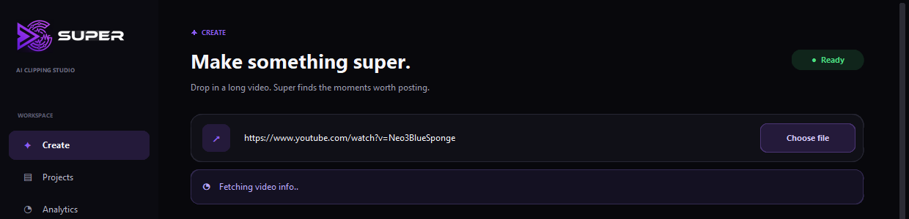

# Super

Super turns long videos into short, caption-ready clips on Windows.

It keeps everything in one compact window: pick a file or paste a link, tune the
score and duration, preview the original alongside 9:16 and 16:9 crops, then
generate captioned clips.

Pasting a link immediately reads that video's title, so you can confirm you picked
the right one before generating anything. The status line starts purple while it
reads, turns green with the video title, and turns red if the link is private or
gone:



## Install

Run `SuperSetup.exe` from the latest release. It asks which drive to install on
(each disk is listed with its free space, and the folder can be browsed), then:

1. checks the public update manifest,
2. downloads the full installer with live speed and time remaining,
3. installs Super for the current user (no admin prompt),
4. offers to open the folder or launch the app.

`SuperSetup.exe` needs an internet connection the first time because it always
fetches the latest build.

## Updates

Auto-update is disabled in this build because no release server is configured.
The old manifest URL pointed at a repository that does not exist, so every
launch waited on a 404. To turn updates back on, set `UPDATE_MANIFEST_URL` in
`version.py` to a hosted `update.json` (or set the `SUPER_UPDATE_URL`
environment variable) and rebuild.

Once configured, the installed app reads the manifest on launch. When a newer
version is published it offers **Update now**, downloads the new `Super.exe`,
verifies its SHA-256, then restarts into it. Nothing to reinstall and no admin
rights required.

Releases are built and hosted as described in
[`installer/README.md`](installer/README.md).

## Run from source

```powershell
python -m pip install -r requirements.txt
python app.py
```

The app uses Python 3.13, CustomTkinter, Whisper, MoviePy and yt-dlp. ffmpeg is
provided by `imageio-ffmpeg`.

## Build a release

Inno Setup 6 is required for the installer:

```powershell
winget install -e --id JRSoftware.InnoSetup
```

Then:

```powershell
.\installer\build_release.ps1 -Version 1.0.0 `
  -AssetUrl "https://github.com/YOU/super/releases/download/v1.0.0/Super.exe" `
  -ManifestUrl "https://github.com/YOU/super/releases/latest/download/update.json"
```

Outputs to `release\`: `Super.exe`, `Super-Setup-1.0.0.exe`, `SuperSetup.exe`
and `update.json`.

## Tests

```powershell
python -m pytest -q
```
